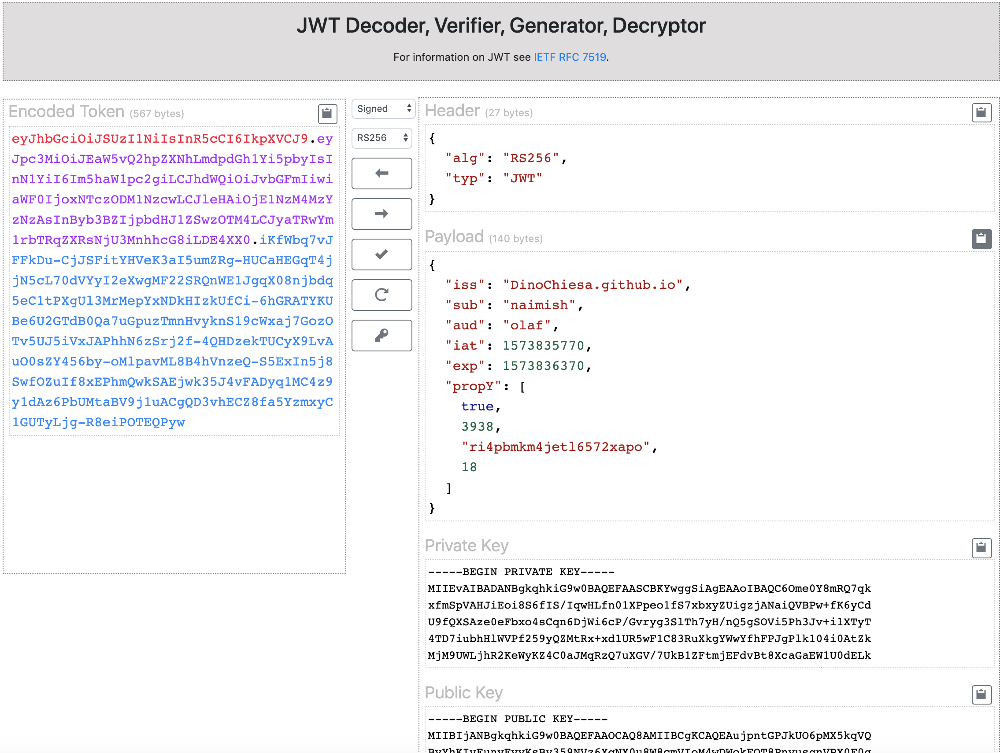

# HTTP Message Signatures Web tool

This is the source code for a web tool that can create and verify HTTP Message
Signatures, as defined in [RFC 9421](https://www.rfc-editor.org/rfc/rfc9421).
It has some limitations!



## License

This code is Copyright (c) 2020 Google LLC, and is released under the Apache
Source License v2.0. For information see the [LICENSE](LICENSE) file.

## Purpose

I built this as a tool that might be helpful to developers learning HTTP
Message Signatures, or experimenting with them.  The output of this repo is
currently running [here](https://dinochiesa.github.io/httpsig/).

Earlier versions implemented the draft-cavage-http-signatures specification.
RFC 9421 supersedes that draft; this tool now implements only RFC 9421.

## Disclaimer

This tool is not an official Google product, nor is it part of an official
Google product.

## Features and limitations

 - algorithms: rsa-pss-sha512, rsa-v1_5-sha256, ecdsa-p256-sha256,
   ecdsa-p384-sha384, ed25519, hmac-sha256.

 - covered components: HTTP fields, and the derived components @method,
   @target-uri, @authority, @scheme, @request-target, @path, @query,
   @query-param, and @status. The sf, key, bs, req, and tr component
   parameters are not supported.

 - signature parameters: created, expires, keyid, alg, nonce, tag.

 - Content-Digest ([RFC 9530](https://www.rfc-editor.org/rfc/rfc9530)): a button
   sets the header from the message body (sha-256 or sha-512), and Verify warns
   when a covered Content-Digest does not match the body.

 - keys: PEM. PKCS#8 and SPKI, plus PKCS#1 RSA keys and SEC1 EC private keys.

 - This tool uses webcrypto, which means it will run only on modern, current
   browsers. Ed25519 needs a recent browser.

## Design

This is a single-page web app. It has no "backend" supporting it. All
signing and verifying happens within the browser.
Anything a user pastes into the UI never leaves the browser. It just needs a few
static files.

## Dependencies

The web app has no runtime dependencies beyond the browser:
* [webcrypto](https://developer.mozilla.org/en-US/docs/Web/API/Web_Crypto_API) - for key generation, PBKDF2, signing and verifying

## Build Dependencies

This tool uses [Vite](https://vite.dev/) for bundling the assets, and
[Sass](https://sass-lang.com/) for the stylesheet.

## Please send pull requests

I'm always looking for constructive feedback.

## Developing

If you fork this repo to mess with the code, here's what I advise.

During development, run the Vite dev server, which reloads the page as you
modify the source code:

```
npm run dev
```

To run the tests, which check the implementation against the test vectors in
RFC 9421 Appendix B:

```
npm test
```

To build a production distribution into `dist/`:

```
npm run build
```

To serve the production build locally:

```
npm run preview
```

## Bugs

* ??
